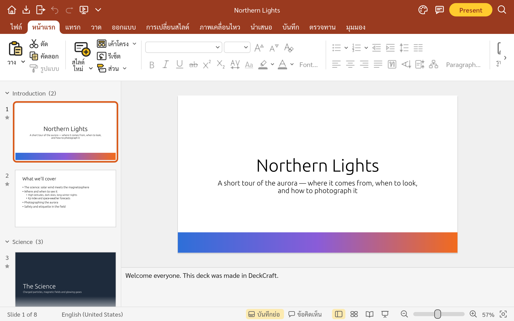
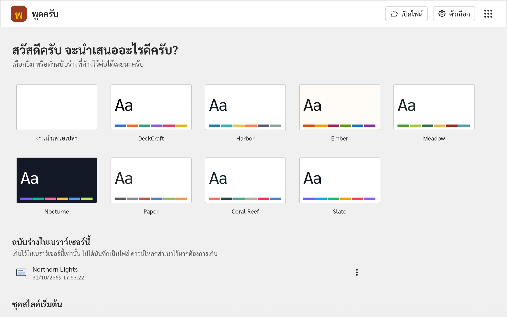
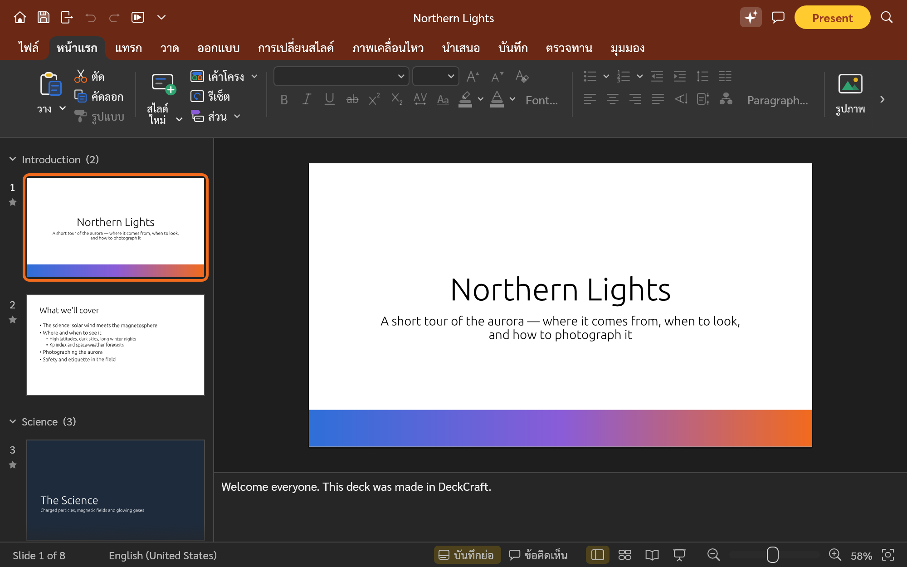
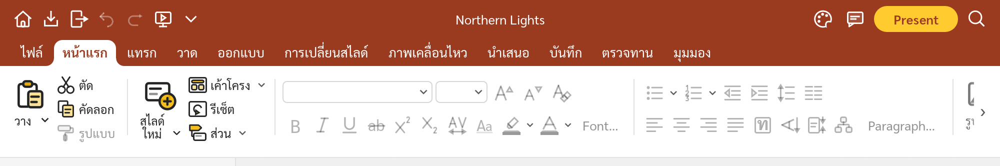
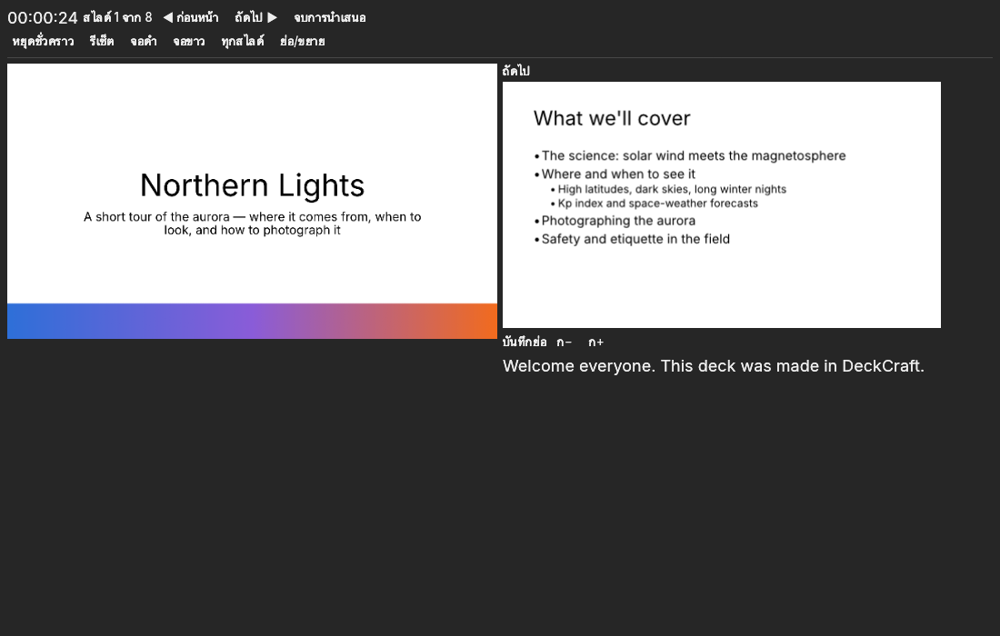
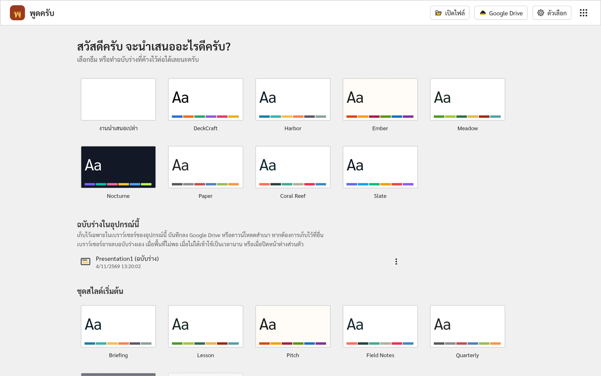

  

# พูดครับ · PhutKrub Web v0.5.0

**โปรแกรมทำงานนำเสนอภาษาไทยและภาษาอังกฤษ ใช้งานฟรีบนเว็บ**

**A free browser-based presentation app for Thai and English.**

**[เปิดใช้งาน / Open PhutKrub](https://phutkrub.app/)** · [KrubOffice](https://kruboffice.app/) · [เขียนครับ · KhianKrub](https://khiankrub.app/) · [คิดครับ · KhitKrub](https://khitkrub.app/)

  

## ประกาศภาษาไทย

**พูดครับบนเว็บ (PhutKrub Web) v0.5.0** เปิดและบันทึกไฟล์ใน Google Drive ได้แล้ว พร้อมมุมมองผู้บรรยายในหน้าต่างแยกครับ

- **Google Drive** เชื่อมต่อ Google Drive ในคลิกเดียวแบบเดียวกับเขียนครับ เปิดงานนำเสนอ `.pptx` จาก Drive แก้ไขแล้วกดบันทึก (Ctrl+S) ไฟล์เดิมใน Drive จะถูกบันทึกทับ หรือบันทึกเป็นสำเนาใหม่ก็ได้ โปรแกรมเข้าถึงเฉพาะไฟล์ที่คุณเลือกหรือที่โปรแกรมสร้างเท่านั้น
- **มุมมองผู้บรรยายในหน้าต่างแยก** เมื่อเริ่มนำเสนอ สไลด์จะแสดงเต็มแท็บเดิม และมุมมองผู้บรรยายเปิดในหน้าต่างใหม่ พร้อมสไลด์ปัจจุบัน สไลด์ถัดไป บันทึกย่อ และตัวจับเวลา ภาพตรงกับที่ผู้ชมเห็น รวมทั้งภาพเคลื่อนไหวทีละขั้น ควบคุมการนำเสนอได้จากหน้าต่างใดก็ได้ ปุ่มและข้อความเป็นภาษาไทย หากเบราว์เซอร์บล็อกป๊อปอัป กดปุ่ม เปิดหน้าต่างมุมมองผู้บรรยาย หลังอนุญาตป๊อปอัป
- **ฉบับร่างในอุปกรณ์นี้** งานนำเสนอใหม่ที่ยังไม่ได้บันทึกเป็นไฟล์หรือลง Google Drive เรียกว่าฉบับร่างอย่างชัดเจน หน้าเริ่มต้นแสดง **ชื่อ (ฉบับร่าง)** แถบชื่อด้านบนแสดง **(ฉบับร่าง) — บันทึกในอุปกรณ์นี้แล้ว** และเมื่อทุกอย่างถูกเก็บแล้ว ปิดแท็บได้โดยเบราว์เซอร์ไม่ถาม
- **ถามก่อนปิดแท็บเมื่องานจะหาย** ไฟล์ที่เปิดจากเครื่องหรือ Google Drive ที่ยังมีการแก้ไขค้างอยู่ เบราว์เซอร์จะถามก่อนปิดแท็บ
- **ถามบันทึกการเปลี่ยนแปลงเป็นภาษาไทย** ปุ่ม ไม่บันทึก และ ยกเลิก เป็นภาษาไทยแล้ว และปุ่ม ยกเลิก ในกล่องโต้ตอบทุกกล่องด้วย
- **ไฟล์ › เกี่ยวกับ** แทนหน้าบัญชีเดิม มีรุ่นของโปรแกรม ลิงก์ และผู้ร่วมพัฒนา
- **รูปร่างที่ไม่มีสีเติม** คลิกผ่านไปเลือกสิ่งที่อยู่ข้างใต้ได้
- **จัดรูปแบบรูปร่าง** มีเอฟเฟกต์เงา เรืองแสง และขอบนุ่มแบบสำเร็จรูป และปรับสัดส่วนความสูง/ความกว้างได้
- **แก้ไขข้อผิดพลาด** บานหน้าต่างข้อคิดเห็นไม่ขยายเองอีกต่อไป และเมนูเพิ่มภาพเคลื่อนไหวเลื่อนดูได้เมื่อยาวกว่าหน้าจอ
- **ไฟล์ PowerPoint** เก็บรายละเอียดได้ครบขึ้น เช่น ตารางจากขวาไปซ้าย เงาสะท้อน และลายเติมแบบกระเบื้อง
- **ทนทานขึ้น** จำกัดงานที่ไฟล์ผิดปกติสั่งให้ทำ เพื่อไม่ให้โปรแกรมค้างหรือปิดตัวเอง

## English announcement

**PhutKrub Web v0.5.0** adds Google Drive and Presenter View in its own window.

- **Google Drive.** Connect Google Drive in one click, as in KhianKrub: open a `.pptx` presentation from Drive, edit it, and Save (Ctrl+S) puts it back over the same file, or save a new copy. The app sees only the files you pick or it creates.
- **Presenter View in its own window.** When a show starts, the slides fill this tab and Presenter View opens in a new window with the current and next slide, notes and a timer. It shows what the audience sees, animation steps included, and either window controls the show. Its buttons and messages are in Thai. If the browser blocks the pop-up, allow pop-ups and press **Open presenter window**.
- **Drafts on this device.** A new presentation not yet saved as a file or to Google Drive is plainly called a draft: the start screen lists **Name (draft)**, the title bar reads **(draft) — Saved on this device**, and once everything is kept the tab closes without the browser asking.
- **Asks before closing when work would be lost.** A file opened from this device or Google Drive with unsaved edits makes the browser ask before the tab closes.
- **Save Changes in Thai.** Don't Save and Cancel are in Thai, and so is Cancel in every dialog.
- **File › About** replaces the old account page, with the app's version, links and contributors.
- **Shapes with no fill** can be clicked through to select what's underneath.
- **Format Shape** has shadow, glow and soft-edge presets, and height and width scaling.
- **Fixes.** The Comments pane no longer grows by itself, and the Add Animation menu scrolls when it's taller than the screen.
- **PowerPoint files** keep more detail, such as right-to-left tables, reflections and tiled fills.
- **Sturdier.** The work an unusual file can ask for is limited, so the app doesn't hang or close.

## หน้าตาโปรแกรม / A look around

<table>
<tr>
<td width="50%" valign="top">
<b>หน้าเริ่มต้น / Start screen.</b> ธีม ฉบับร่างในเบราว์เซอร์ และชุดสไลด์เริ่มต้น / Themes, drafts kept in this browser, and starter decks.
</td>
<td width="50%" valign="top">
<b>ธีมมืด / Dark theme.</b> สไลด์ยังขาวเหมือนตอนนำเสนอ / The slide stays as it will be shown.
</td>
</tr>
</table>

### ไอคอนชุดใหม่และกระจายแบบไทย / New icons and Thai Distribution

  

## ความสามารถ / Features

| ภาษาไทย | English |
|---|---|
| สร้างสไลด์จากธีมและชุดสไลด์เริ่มต้น ใส่รูปร่าง รูปภาพ ตาราง และแผนภูมิ | Start from themes and starter decks; add shapes, pictures, tables and charts |
| เอฟเฟกต์การเปลี่ยนสไลด์ ภาพเคลื่อนไหว และนำเสนอเต็มจอ | Transitions, animations and a full-screen slide show |
| มุมมองผู้บรรยายในหน้าต่างแยก: สไลด์ปัจจุบัน สไลด์ถัดไป บันทึกย่อ และตัวจับเวลา | Presenter View in its own window: the current and next slide, notes and a timer |
| เปิดและบันทึกไฟล์ PowerPoint (`.pptx`) | Open and save PowerPoint files (`.pptx`) |
| เปิดและบันทึกไฟล์ใน Google Drive: เชื่อมต่อในคลิกเดียว กดบันทึกแล้วไฟล์เดิมใน Drive ถูกบันทึกทับ หรือบันทึกเป็นสำเนาใหม่ | Open and save files in Google Drive: connect in one click, Save puts the file back in Drive, or save a new copy |
| เมนูภาษาไทยและภาษาอังกฤษ เปิดครั้งแรกเป็นภาษาไทย บางส่วนยังเป็นภาษาอังกฤษ | Thai and English menus; the first visit opens in Thai; some text is still English |
| สไลด์ใหม่ใช้ฟอนต์ TH Sarabun New เมนูใช้ Sarabun | New slides use TH Sarabun New; menus use Sarabun |
| หน้าเริ่มต้นพร้อมฉบับร่างในอุปกรณ์นี้ ให้ทำต่อ ดาวน์โหลด หรือทิ้ง | A start screen with the drafts on this device, to keep working, download or discard |
| งานใหม่บันทึกเป็นฉบับร่างในอุปกรณ์นี้อัตโนมัติ ปิดแท็บได้โดยไม่หาย | New work is saved automatically as a draft on this device, so closing the tab loses nothing |
| ธีมสว่างและธีมมืด | Light and dark themes |
| จัดข้อความแบบกระจายไทย (ปุ่มตัว ท ในแท็บหน้าแรก) | Thai Distribution (the ท button on the Home tab) |

## มุมมองผู้บรรยาย / Presenter View

เมื่อเริ่มนำเสนอ พูดครับจะแสดงสไลด์ในแท็บนี้ และเปิด **มุมมองผู้บรรยาย** ในหน้าต่างใหม่ของเบราว์เซอร์ ย้ายหน้าต่างนี้ไปไว้บนจอของคุณ แล้วให้แท็บที่แสดงสไลด์อยู่บนจอโปรเจกเตอร์แบบเต็มจอ มุมมองผู้บรรยายแสดงสไลด์ปัจจุบัน สไลด์ถัดไป บันทึกย่อ และตัวจับเวลา กดถัดไป ก่อนหน้า จอดำ จอขาว หรือเลือกสไลด์จากทุกสไลด์ได้จากหน้าต่างใดก็ได้ ทั้งสองหน้าต่างคุยกันภายในเบราว์เซอร์เท่านั้น ไม่มีข้อมูลส่งออกจากเครื่อง หากเบราว์เซอร์บล็อกป๊อปอัป จะมีปุ่ม **เปิดหน้าต่างมุมมองผู้บรรยาย** ให้อนุญาตป๊อปอัปสำหรับ phutkrub.app แล้วกดปุ่มนั้น ปิดหน้าต่างไปแล้วก็เปิดใหม่ได้ด้วยปุ่มเดียวกัน ภาพในมุมมองผู้บรรยายตรงกับที่ผู้ชมเห็น รวมทั้งภาพเคลื่อนไหวทีละขั้น ปิดได้ที่ปุ่ม **มุมมองผู้บรรยาย** ในแท็บนำเสนอ

When a show starts, PhutKrub shows the slides in this tab and opens **Presenter View** in a new browser window. Keep that window on your screen and the tab full screen on the projector. Presenter View shows the current and next slide, the notes and a timer; Next, Previous, Black and White screen and All slides work from either window. The two windows talk inside the browser only; nothing leaves the device. If the browser blocks the pop-up, an **Open presenter window** button appears: allow pop-ups for phutkrub.app and click it; the same button reopens a closed presenter window. Presenter View shows what the audience sees, animation steps included. Turn it off with the **Presenter View** button on the Slide Show tab.

## ฉบับร่างในอุปกรณ์นี้ / Drafts on this device

พูดครับบนเว็บไม่มีพื้นที่เก็บไฟล์บนเซิร์ฟเวอร์ งานนำเสนอใหม่ที่ยังไม่ได้บันทึกเป็นไฟล์หรือลง Google Drive จะเก็บเป็น **ฉบับร่าง** ในเบราว์เซอร์ของอุปกรณ์นี้โดยอัตโนมัติ แถบชื่อด้านบนแสดง **ชื่อ (ฉบับร่าง) — บันทึกในอุปกรณ์นี้แล้ว** เมื่อทุกอย่างถูกเก็บแล้ว ปิดแท็บได้ทันที หน้าเริ่มต้นจะแสดงในชื่อ **ชื่อ (ฉบับร่าง)** จนกว่าคุณจะทิ้ง ส่วนไฟล์ที่เปิดจากเครื่องหรือ Google Drive เบราว์เซอร์จะถามก่อนปิดแท็บหากยังมีการแก้ไขที่ยังไม่ได้บันทึก

There is no server storage. A new presentation not yet saved as a file or to Google Drive is kept automatically as a **draft** in this device's browser. The title bar reads **Name (draft) — Saved on this device** once everything is kept, and the tab can be closed straight away; the start screen lists it as **Name (draft)** until you discard it. For a file opened from this device or Google Drive, the browser asks before the tab closes with unsaved edits.

- หากเบราว์เซอร์ไม่รับปากว่าจะเก็บข้อมูลไว้ หน้าเริ่มต้นจะเตือนว่าอาจลบฉบับร่างเองได้ / If the browser does not agree to keep the site's storage, the start screen warns that it may remove drafts by itself.

## เริ่มใช้งาน / Getting started

1. เปิด / Visit **[phutkrub.app](https://phutkrub.app/)** บนคอมพิวเตอร์หรือ iPad / on a computer or iPad.
2. ที่หน้าเริ่มต้น เลือกธีม ชุดสไลด์ หรือฉบับร่าง หรือกด **เปิดไฟล์** / On the start screen, pick a theme, a starter deck or a draft, or press **Open file**.
3. บันทึกงานผ่าน **ไฟล์ → บันทึก** แล้วเก็บไฟล์ไว้ในเครื่อง / Save through **File → Save** and keep the file on your device.

## ที่มา / Credits

PhutKrub is Chanon Sarasuk's Thai adaptation of [DeckCraft](https://github.com/storytold/deckcraft) by the ArtCraft team (MIT OR Apache-2.0), one of the apps in [KrubOffice](https://kruboffice.app/). It is not an ArtCraft product and is not affiliated with Microsoft. The screenshots are taken from the running app and show DeckCraft's original sample deck. This repository holds the compiled site only; the source code is private. Third-party components keep their own licences: see `ATTRIBUTION.md`, `NOTICE`, and `fonts/` (Sarabun: SIL OFL 1.1; TH Sarabun New: GPL with the font exception).

Prepared from version **0.5.0**, source commit `f5bcb619`.
